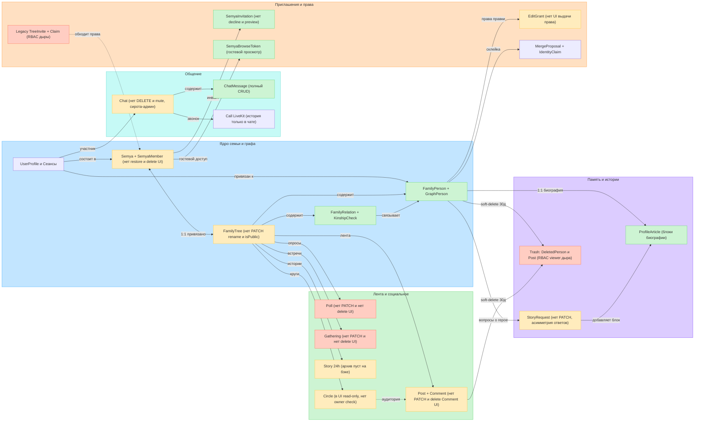
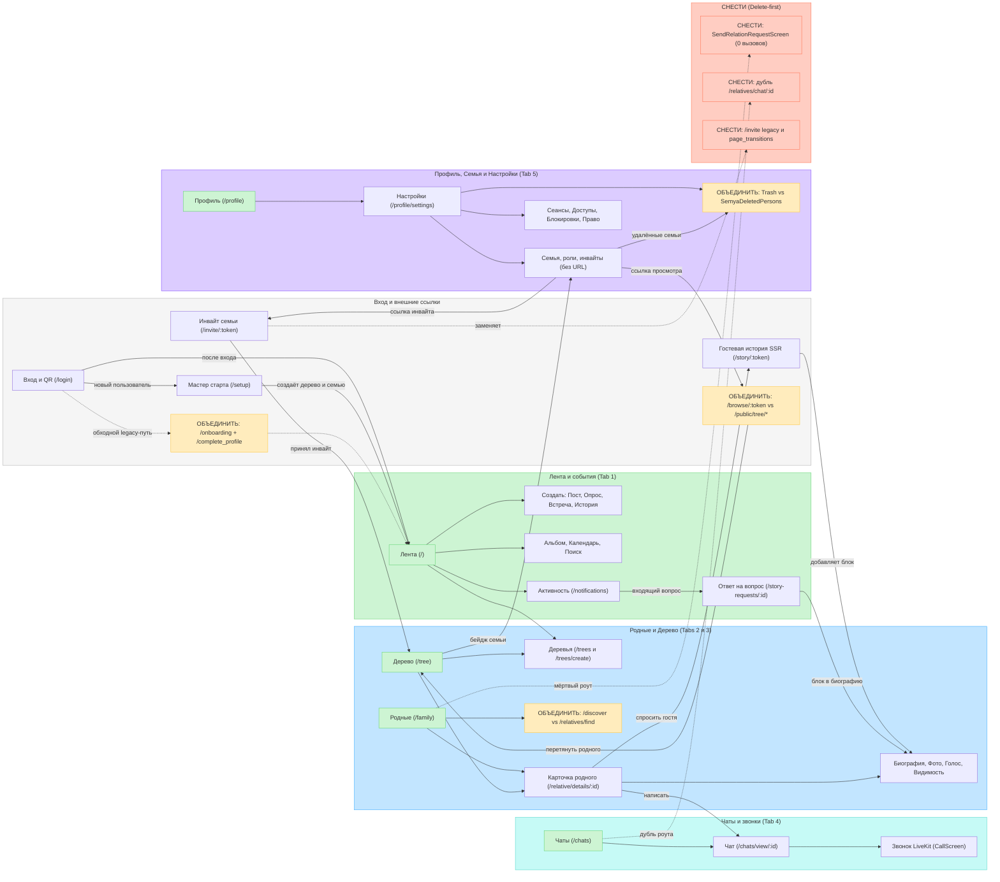

# Родня — Единая карта сущностей, прав и экранов (OOUX + Breadboard)

> **Статус:** Живой источник правды (Step 1 & Step 2 по навыку `product-integration-workflow`, **ожидает согласования** до перехода к макетам/коду).  
> **Дата аудита:** 2026-11-27 (проверено по реальному коду `lib/` и `backend/src/`).  
> **Интерактивная схема экранов в FigJam:** [Родня — Карта экранов (Breadboard)](https://www.figma.com/board/S4XrhlvvG6iJput7R6Pnpb) *(вторую диаграмму OOUX-связей не удалось дозагрузить в FigJam из-за исчерпания лимита вызовов MCP на плане Starter, поэтому её актуальная Mermaid-версия встроена прямо в Раздел 1 ниже).*  
> **Правила работы с картой:**
> 1. **Схема → Макет → Код (Integration-first):** перед крупной фичей или переделкой экрана сначала обновляем эту карту, затем согласуем макет + 5-State Matrix, затем пишем код.
> 2. **Delete-first:** старые дубли, мёртвые роуты и legacy-экраны удаляются в том же коммите, а не накрываются сверху.
> 3. **Полный цикл (`CRUD × Роли`):** ни одна пользовательская сущность не вводится без цикла `Создать · Открыть · Изменить/Переименовать · Поделиться · Скрыть/Архивировать · Удалить` (или явно задокументированного ограничения в матрице ниже) с проверкой владельца (`ownerId / creatorId / userId === user.id`), а не хардкодом legacy-роли.

---

## 1. ORCA — Карта сущностей, связей и ролевой модели

### 1.1 Визуальная карта сущностей и основных проблем CRUD/RBAC



### 1.2 Ролевая модель и проверки доступа (`backend/src/middleware/access-guards.js`)

| Роль / уровень | Как определяется в коде | Что может по замыслу | Известные оговорки / расхождения |
|---|---|---|---|
| **Owner (`owner`)** | `SemyaMember.role === 'owner'` (ранг 3 в дереве / 2 в семье); либо владелец ресурса (`userId`, `creatorId`, `authorId`) | Управление семьёй, ролями, `hasInviteGrant`, отзыв любых инвайтов/токенов, удаление дерева, управление привязанными персонами | В legacy-пути (`!tree.semyaId` или `RODNYA_FEDERATED_SEMYI_ENABLED=false`) `requireTreeAccess` игнорирует `requiredRole`. `include-rules` проверяет только `tree.creatorId`. Владелец семьи не может модерировать чужие посты/опросы/встречи. |
| **Editor (`editor`)** | `SemyaMember.role === 'editor'`; опционально флаг `hasInviteGrant` | Добавление/правка неклеймленных персон, связей, кругов, мердж (с грантами), публикация в ленте | С `hasInviteGrant` может приглашать и создавать browse/claim-токены. *(Исправлено в Wave A: legacy `TreeInvitation` теперь тоже проверяет `hasInviteGrant` и не позволяет редактору разбанить кикнутого.)* |
| **Viewer (`viewer`)** | `SemyaMember.role === 'viewer'` | Чтение дерева, ленты, биографий, карточек, чатов; правка **только своей** привязанной персоны; реакции, комментарии, голоса в опросах и RSVP во встречах | *(Исправлено в Wave A: `viewer` больше НЕ может публиковать посты/истории/опросы/встречи и НЕ может восстанавливать/чистить чужих людей в `DeletedPerson`.)* |
| **Person Steward / Grantee** | `graphPerson.userId || createdBy` или активный `GraphPersonEditGrant` (`edit`, `soft-delete`, `merge-consent`) | Правка, удаление или склейка конкретной клеймленной персоны | `PUT /persons/:id/attributes` дополнительно требует `_isPersonSteward` даже при наличии `EditGrant`. В UI нет точки выдачи `addGraphPersonGrant`. |
| **Guest (Anonymous)** | Capability-токен `/story/:token`, `/browse/:token`, публичное дерево `/public/tree/:id` | Ответ на «Спросить историю v2» (аудио/текст/фото), чтение урезанного дерева (`browse`) или публичного дерева (`public`) | У `/public/trees/*` нет переключения приватности после создания дерева. |
| **Admin** | `RODNYA_BACKEND_ADMIN_EMAILS` (`requireAdmin`) | Просмотр и резолв жалоб (`/v1/admin/reports*`), диагностика (`/v1/admin/runtime`, `client-diagnostics`) | Только серверная модерация жалоб; системный доступ. |

### 1.3 Связи объектов (Relationships) и модель хранения

Rodnya использует гибрид PostgreSQL + JSONB (`public.rodnya_state.data` + вынесенные таблицы SPEED-6/7/8b/15 без SQL `FOREIGN KEY` — связи поддерживаются в JS-сторе `backend/src/store/`):

```text
User (id, identityId -> PersonIdentity.id)
 ├── 1:N -> Session (таблица auth_sessions), PushDevice, Notification (таблица notifications)
 ├── 1:1 -> OnboardingState (treeId -> FamilyTree.id, personIds[])
 ├── 1:N -> SemyaMember (semyaId -> Semya.id, role: owner|editor|viewer, hasInviteGrant, hiddenAt)
 ├── 1:N -> Block, Report, ProfileContribution (authorUserId -> targetUserId), KinshipCheck
 └── 0..1 -> PersonIdentity <-> 1:1 GraphPerson (id == identityId, visibility)
                                  ├── 1:N -> GraphPersonEditGrant (scope: edit|soft-delete|merge-consent)
                                  └── 1:N -> GraphRelation

Semya (id, ownerId -> User.id, treeId -> FamilyTree.id [1:1], deletedAt)
 ├── 1:N -> SemyaMember
 ├── 1:N -> SemyaInvitation (inviterUserId, recipientUserId/Email/Phone, token)
 ├── 1:N -> SemyaBrowseToken (createdByUserId, token)
 └── 1:N -> SemyaMemberHiddenPerson (userId, personId)

FamilyTree (id, creatorId -> User.id, semyaId -> Semya.id [nullable], memberIds[], kind: family|friends)
 ├── 1:1 -> Branch (includeRules)
 ├── 1:N -> FamilyPerson (treeId, userId [nullable], identityId, photoGallery[])
 │          ├── 1:1 -> ProfileArticle (blocks[{id, type, content, authorUserId, source}])
 │          ├── 1:N -> PersonAttribute
 │          ├── 1:N -> StoryRequest (requesterUserId, targetUserId [nullable], deliveryMode, shareToken)
 │          └── soft-delete (30d) -> DeletedPerson (таблица deleted_persons)
 ├── 1:N -> FamilyRelation (person1Id, person2Id, unionStatus, parentSetId)
 ├── 1:N -> Circle (kind: all_tree|favorites|descendants_of|ancestors_of|pair|custom) -> CircleMember
 ├── 1:N -> Post (branchIds[], circleId, imageUrls[], anchorPersonIds[])
 │          ├── 1:N -> Comment (2 уровня), PostReaction
 │          └── soft-delete (30d) -> DeletedPost
 ├── 1:N -> Story (24h), Poll, Gathering
 └── legacy -> TreeInvitation, RelationRequest

Chat (id, type: direct|group|branch, participantIds[], createdBy)
 ├── 1:N -> ChatMessage (таблица chat_messages), ChatReaction, ChatDraft, ChatPin
 └── 1:N -> Call (LiveKit room, participantIds[], итог записывается в ChatMessage)
```

### 1.4 Non-Goals и Rabbit Holes (зафиксированные границы)

- **Non-Goals (чего НЕ делаем сейчас):**
  - Не переписываем гибридное хранилище `rodnya_state` в полностью нормализованный SQL без отдельного migration RFC.
  - Не строим корпоративный RBAC-конструктор (хватает `owner / editor (+hasInviteGrant) / viewer` + `person owner / EditGrant` + capability tokens).
  - Не возвращаем RuStore/Supabase, телефоно-поиск (410) и платные подписки в рамках текущего цикла.
  - Не дублируем отдельный экран истории звонков до появления продуктового запроса (звонки живут в таймлайне чата).
- **Rabbit Holes (скрытые ловушки при будущих доработках):**
  1. **Рассинхрон `Semya` ↔ `FamilyTree`:** переименование семьи (`PATCH /v1/semya/:id`) не меняет `tree.name`; удаление дерева бьёт всё хардом + soft-delete семьи, а удаление семьи оставляет дерево без владельца; переименовать дерево нельзя вообще.
  2. **Claimed vs Anonymous `FamilyPerson`:** привязанная к реальному аккаунту карточка защищена `owner` + `EditGrant`, но обходы через legacy `pending/process` или `DeletedPerson` (viewer!) ломают эту защиту.
  3. **Удаление аккаунта (`deleteUser`):** удаление последнего `owner` оставляет бесхозную `Semya`, куда никто не может войти как владелец.
  4. **Выход создателя из группового чата:** `createdBy` может уйти через `/leave`, но права кикать зашиты на `chat.createdBy === caller` и не передаются.
  5. **Двойной источник правды в приглашениях/онбординге:** старые роуты `/onboarding`, `/complete_profile`, `/invite?treeId=&personId=`, `TreeInvitation` и `/public/tree/*` всё ещё смонтированы и конкурируют с `/setup`, `/invite/:token` и `/browse/:token`.

---

## 2. Матрица жизненного цикла (`Сущность × CRUD × Роли`)

Обозначения: **Back ✓** = эндпоинт есть · **UI ✓** = подключено в интерфейсе · **⚠️** = частично / с оговоркой / без UI · **❌** = отсутствует.

| Сущность | Create | Read / Open | Update / Rename | Share / Access | Archive / Hide / Restore | Delete / Leave | Владелец / Роли | Главный пробел (Back vs UI) |
|---|---|---|---|---|---|---|---|---|
| **1. `UserProfile` / Account** | Back ✓ (`register`, OAuth)<br>UI ✓ (`/login`, `/setup`) | Back ✓ (`profile/me`, `users/:id/profile`)<br>UI ✓ (`/profile`, `/user/:id`) | Back ✓ (`PATCH /profile/me`, `bootstrap`)<br>UI ✓ (`showProfileEditSheet`) | Back ✓ (поиск, discovery)<br>UI ✓ (`/user/:id`, код) | ❌ нет деактивации | Back ✓ (`DELETE /auth/account`)<br>UI ✓ (`SettingsScreen`) | Только сам пользователь | Нет смены пароля внутри сессии; нет unlink OAuth; `PATCH /users/:id/profile` не синкает фото; `ProfileNote` без UI *(Wave A починил передачу `Semya` и 3 поля GDPR в `deleteUser`)* |
| **2. `FamilyTree`** | Back ✓ (`POST /trees`)<br>UI ✓ (`/trees/create`) | Back ⚠️ (только списки, нет `GET /:treeId`)<br>UI ✓ (`/trees`, `/tree`) | **❌ нет `PATCH /trees/:treeId`**<br>UI ❌ (кроме `include-rules` в модели) | ⚠️ `isPublic` задаётся только при создании | ❌ нет архива/корзины дерева | Back ✓ (`DELETE /trees/:id`: owner=hard, member=leave)<br>UI ✓ (`/trees`) | Owner / `tree.creatorId` (`include-rules` захардкожен на `creatorId`) | **Нет переименования/редактирования и переключения приватности дерева**; hard-delete без корзины; legacy `/public/trees/*` ещё живы |
| **3. `Semya` & `SemyaMember`** | Back ✓ (`POST /semya` + auto-bind)<br>UI ⚠️ (auto-bind + бейдж в дереве) | Back ✓ (`GET /me/semya`, `/semya/:id`)<br>UI ✓ (`SemyaDetailsScreen`) | Back ✓ (`PATCH /semya/:id`, роли/гранты)<br>UI ✓ (owner) | Back ✓ (инвайты + browse)<br>UI ✓ | Back ⚠️ (`SemyaMember` скрывается `hiddenAt`; у `Semya` `deletedAt` **без restore**)<br>UI ❌ | Back ✓ (`DELETE /semya/:id` owner soft; `DELETE /membership` leave/kick)<br>UI ⚠️ (**только Leave**, нет UI удаления семьи) | `Semya` owner (`editor+hasInviteGrant` только для приглашений) | **Нет UI удаления `Semya`**, нет restore мягко удалённой `Semya`, не чистится `hardDeleteExpired`, переименование не синкает `tree.name` |
| **4. `SemyaInvitation`** | Back ✓ (`POST /semya/:id/invitation`)<br>UI ✓ (`SemyaInviteScreen`) | Back ✓ (список, нет `GET /:token` preview)<br>UI ✓ (`SemyaInvitationsListScreen`, `/invite/:token`) | ❌ нельзя сменить роль/срок | Back ✓ (токен / email)<br>UI ✓ | ❌ | Back ✓ (`DELETE` отзыв; `accept` по токену; **нет `decline`**)<br>UI ✓ (отзыв/принятие) | Owner или `editor + hasInviteGrant`; принятие по токену | Нет `decline` получателем, нет preview до принятия, нельзя сделать открытую одноразовую ссылку без email/userId/phone |
| **5. `SemyaBrowseToken`** | Back ✓ (`POST /browse-token`)<br>UI ✓ (`ShareBrowseTokenModal`) | Back ✓ (`GET /browse-tokens`, публичный `GET /browse/:token`)<br>UI ✓ (`/browse/:token`, список) | ❌ нет имени/метки и продления срока | Back ✓ (capability-токен)<br>UI ✓ | ❌ | Back ✓ (`DELETE /browse-token/:id`)<br>UI ✓ (отзыв) | Owner, `editor + hasInviteGrant` или `createdByUserId` | Нельзя подписать назначение ссылки или продлить срок |
| **6. Legacy `TreeInvitation` / `Pending` / `RelationRequest`** | Back ✓ (все 3 смонтированы)<br>UI ✓ (`TreeSelector`, `FindRelative`) | Back ✓ (`pending` / `relation-requests`)<br>UI ✓ (`RelationRequestsScreen`, `/trees?tab=invitations`) | ❌ | ⚠️ `/invite?treeId=&personId=` + `claim-token` | ❌ | Back ⚠️ (`TreeInvitation` без `DELETE`; `RelationRequest` `canceled` ломает 403 для отправителя) | Owner или `editor + hasInviteGrant` *(Wave A)* | Legacy-инвайты ещё дублируют `SemyaInvitation`; `RelationRequest` без отмены отправителем *(Wave A закрыл un-kick редактором и добавил серверный `claim-token`)* |
| **7. `FamilyPerson` & `GraphPerson`** | Back ✓ (`POST /persons`, `import`, `pull-person`)<br>UI ✓ (`/relatives/add`, quick-add, pull) | Back ✓ (`persons`, `dossier`, `search`, `graph-persons/:id`)<br>UI ✓ (`/tree`, `/family`, `/relative/details/:id`) | Back ✓ (`PATCH`, медиа, атрибуты, visibility)<br>UI ✓ (полная правка) | Back ✓ (гранты, visibility, pull)<br>UI ⚠️ (нет UI выдачи `EditGrant`) | Back ✓ (soft-delete 30d + `hide-filter`)<br>UI ✓ (скрыть в семье + корзина) | Back ✓ (soft-delete + `unlink`)<br>UI ✓ | Anon: `editor+`; Claimed: owner или `EditGrant` | `GET /persons/:id` не проверяет `hide-filter`; `PUT /attributes` требует `_isPersonSteward` *(Wave A починил отзыв `semyaMembers` при `unlinkUserFromPerson`)* |
| **8. `FamilyRelation` & `KinshipCheck`** | Back ✓ (`POST /relations`, `kinship-checks`)<br>UI ✓ (`AddRelative`, `Tree`, `Discover`) | Back ✓ (`GET /relations`, `graph/relation`)<br>UI ✓ (`RelativeDetails`, `Discover`) | Back ⚠️ (upsert по паре, нет `PATCH /:id`)<br>UI ✓ (смена типа связи) | — | ❌ (нет архива) | Back ✓ (`DELETE /relations/:id` hard; `kinship/revoke`)<br>UI ✓ | `editor+` для связей; инициатор/цель для `KinshipCheck` | В UI нельзя изменить даты брака/развода без пересоздания; `DELETE` сразу hard-delete |
| **9. `ProfileArticle` (Биография)** | Back ✓ (авто при 1-м блоке)<br>UI ✓ (`ProfileArticleEditorScreen`) | Back ✓ (`article`, `article/history`)<br>UI ✓ (`ArticleReadView`, `AllPhotos`, `Voice`, `History`) | Back ✓ (`POST/PATCH/PUT order`)<br>UI ✓ (полный редактор блоков) | ❌ (наследует доступ дерева) | ❌ (история read-only, нет rollback) | Back ⚠️ (удаление только по блоку, не всей статьи)<br>UI ✓ (блок) | `requireGraphPersonEdit(..., "edit")` (LWW) | История изменений без кнопки «Откатить»; при purge персоны `profileArticle` остаётся в БД |
| **10. `StoryRequest` («Спросить историю v2»)** | Back ✓ (`POST /story-requests`)<br>UI ✓ (`FamilyStoryQuestionsSheet`) | Back ✓ (`me/story-requests`, `:id`, `/story/:token`)<br>UI ✓ (строка статуса, `Notifications`) | **❌ нет `PATCH`** (нельзя поправить вопрос/срок) | Back ✓ (`shareToken` / `/story/:token`)<br>UI ✓ (копия/шаринг) | ❌ (нельзя скрыть завершённые) | Back ⚠️ (`revoke`/`decline`, нет `DELETE` истории)<br>UI ✓ (`Отозвать`/`Отклонить`) | Инициатор (`edit` персоны или свой вопрос) и адресат / гость с токеном | Гость на `/story/:token` может прислать audio+text+photo+STT вместе, а in-app ответ принимает только 1 тип за раз без транскрипта |
| **11. `Post`** | Back ✓ (`POST /posts`)<br>UI ✓ (`/post/create`, `/post/album`) | Back ⚠️ (только списки; **нет `GET /posts/:id`**)<br>UI ⚠️ (`/post/:id` редиректит на `/`) | **❌ нет `PATCH /posts/:id`**<br>UI ❌ | Back ❌<br>UI ⚠️ (копирует `/post/:id` -> идёт на `/`) | Back ✓ (soft-delete 30d `deletedPosts`)<br>UI ✓ (`TrashScreen`) | Back ✓ (`DELETE` автор / `Semya owner`)<br>UI ✓ | Публикация: `editor+` *(Wave A)*; удаление: автор или `Semya owner` | **Нет редактирования поста**, нет отдельного просмотра по permalink |
| **12. `Comment`** | Back ✓ (`POST /comments`)<br>UI ✓ (`CommentSheet`) | Back ✓ (`GET /comments`)<br>UI ✓ (`CommentSheet`) | **❌ нет `PATCH`**<br>UI ❌ | — | ❌ | Back ✓ (`DELETE` автор / пост / `Semya owner`)<br>**UI ❌ НЕ ПОДКЛЮЧЕНО** | Создание: `viewer+`; удаление: автор коммента/поста или `Semya owner` | **`deleteComment()` уже есть в `PostServiceInterface`, но в `CommentSheet` нет кнопки удаления**; нет редактирования |
| **13. `Story` (24h)** | Back ✓ (`POST /stories`)<br>UI ✓ (`/stories/create`) | Back ✓ (`GET /stories`, view, reactions)<br>UI ✓ (`StoryViewerScreen`) | **❌ нет `PATCH`**<br>UI ❌ | ❌ | Back **❌ не отдаёт истёкшие**<br>UI ⚠️ (`StoryArchiveScreen` всегда пуст) | Back ✓ (`DELETE` hard, автор / `Semya owner`)<br>UI ✓ (в просмотрщике) | Публикация: `editor+` *(Wave A)*; удаление: автор или `Semya owner` | **Экран «Архив историй» в профиле всегда пустой** (бэкенд чистит/не возвращает истёкшие истории) |
| **14. `Poll` (Опросы)** | Back ✓ (`POST /polls`)<br>UI ✓ (`/poll/create`) | Back ✓ (`GET /polls`, `:id`, `respond`)<br>UI ✓ (`PollCard` в ленте) | **❌ нет `PATCH`** (и закрытия/снятия голоса)<br>UI ❌ | ❌ | ❌ | Back ✓ (`DELETE` hard, автор / `Semya owner`)<br>**UI ❌ НЕ ПОДКЛЮЧЕНО** | Создание: `editor+` *(Wave A)*; удаление: автор или `Semya owner` | **`deletePoll()` реализован в сервисе, но у `PollCard` вообще нет меню удаления**; нельзя редактировать/закрыть досрочно |
| **15. `Gathering` (Встречи)** | Back ✓ (`POST /gatherings`)<br>UI ✓ (`/gathering/create`) | Back ⚠️ (`GET /gatherings` требует `treeId`)<br>UI ✓ (`GatheringCard`, `/calendar`) | **❌ нет `PATCH`** (дата/место/текст)<br>UI ❌ | ❌ | ❌ | Back ✓ (`DELETE` hard, автор / `Semya owner`)<br>**UI ❌ НЕ ПОДКЛЮЧЕНО** | Создание: `editor+` *(Wave A)*; удаление: автор или `Semya owner` | **`deleteGathering()` есть в сервисе, но в UI нет удаления**; нельзя перенести дату/место; `GET /gatherings` без `treeId` -> 400 |
| **16. `Chat` & `ChatMessage`** | Back ✓ (`direct`, `groups`, `branches`, `messages`)<br>UI ✓ (`ChatsList`, `ChatScreen`) | Back ✓ (`chats`, `search`, `messages`)<br>UI ✓ (`/chats`, `/chats/view/:id`) | Back ✓ (только группа title/photo, свои сообщения)<br>UI ✓ (`ChatInfoSheet`, правка сообщения) | Back ❌ (сообщения без forward endpoint)<br>UI ⚠️ (forward как пересылка) | Back **❌ нет archive/mute**<br>UI ⚠️ (**локальный** архив/mute в SharedPrefs) | Back ⚠️ (только `leave` группы и delete message; **нет `DELETE /chats/:id`**)<br>UI ⚠️ (только `Leave`) | Любой участник переименовывает группу и добавляет людей; кикает только `createdBy` | **Нельзя удалить/очистить личный чат**, нет серверного mute/архива; уход `createdBy` делает группу навсегда без админа; 2 лишних роута |
| **17. `Call` (LiveKit)** | Back ✓ (`POST /calls`)<br>UI ✓ (`ChatScreen`, `ChatsList`) | Back ✓ (`active`, `:callId`)<br>UI ✓ (`CallScreen`) | Back ✓ (`nudge`, `add`)<br>UI ✓ (добавление в звонок) | ❌ | — | Back ✓ (`reject`, `cancel`, `hangup`)<br>UI ✓ | Участники чата/звонка | Отдельного списка истории звонков нет (история в чате — ОК для текущей версии) |
| **18. `Circle` (Аудитории)** | Back ✓ (`POST /circles`)<br>**UI ❌** | Back ✓ (`circles`, `audience-presets`, `members`)<br>UI ✓ (только выбор аудитории) | Back ✓ (`PATCH`, `PUT members`)<br>**UI ❌** | — | ❌ | Back ✓ (`DELETE custom`)<br>**UI ❌** | Любой `editor+` (нет проверки автора круга!) | **В UI 100% read-only**; на бэке при удалении круга `stories/gatherings/polls` не перепривязываются к `all_tree` |
| **19. `EditGrant`, `Trash`, `MergeProposal`, `Notification`** | Back ✓ (`grants`, soft-delete, `identity-claims`)<br>UI ⚠️ (**нет UI создания `EditGrant`**) | Back ✓ (`issued/edit-grants`, `deleted-persons/posts`, `merge-proposals`, `notifications`)<br>UI ✓ (`/profile/access`, 2 корзины, `/identity/review`, `/notifications`) | Back ✓ (`review`, `conflicts/resolve`, `notifications/read`)<br>UI ✓ | — | Back ✓ (`restore`, `unmerge`)<br>UI ✓ | Back ⚠️ (`grants DELETE`, `trash DELETE`; нет delete у `Notification` и cancel у `IdentityClaim`) | `EditGrant`: владелец; `Trash` posts: автор/owner; `Trash` persons: `editor+` (anon) / owner или grant (claimed) *(Wave A)* | 2 дубля корзин в UI; нет UI выдачи `EditGrant` *(Wave A закрыл P0 дыру с правами `viewer` на `DeletedPerson`)* |

---

## 3. Реестр экранов и маршрутов (Breadboard Inventory)

Всего в проекте **58 файлов `*_screen.dart`** (57 в `lib/screens/` + `kruzhok_recorder_screen.dart` в `lib/widgets/`, содержащих **61 класс экранов** с учётом 4 правовых экранов и 2 классов просмотра историй).

### 3.1 Пять вкладок нижнего бара / Desktop Rail (`StatefulShellRoute`)

| # | Название в UI | Корневой URL | Экран | Бейдж |
|---|---|---|---|---|
| 0 | `Лента` | `/` | `HomeScreen` | Непрочитанные уведомления |
| 1 | `Родные` | `/family` | `RelativesScreen` | Legacy `pendingTreeInvitations` |
| 2 | `Дерево` | `/tree` (`?tree=&name=`) | `TreeViewScreen` | Нет (центр бара; верхний логотип rail ведёт сюда же) |
| 3 | `Чаты` | `/chats` | `ChatsListScreen` | Непрочитанные сообщения |
| 4 | `Профиль` | `/profile` (`?edit=1..3`) | `ProfileScreen` | Нет |

### 3.2 Маршруты-редиректы и перехваты (`AppShellRouteModule` / `AppRouterGuards`)

| URL | Куда перенаправляет | Комментарий |
|---|---|---|
| `/settings` | `/profile/settings` | Короткий алиас настроек |
| `/album` | `/post/album` | Короткий алиас альбома |
| `/relatives` | `/family` | Только корень; подмаршруты `/relatives/add\|edit\|find\|requests\|send_request\|chat` живут наверху |
| `/family?view=tree[&tree=&name=]` | `/tree[?tree=&name=]` | Legacy после выноса дерева на отдельную вкладку |
| `/tree/view/:treeId[?name=]` | `/tree?tree=:treeId[&name=]` | Deep-link из пушей и инвайтов |
| `/profile/edit[?step=0..3]` | `/profile?edit=<step\|1>` | Автооткрывает `showProfileEditSheet` |
| `/post/:postId` | `/` | **Поломанный permalink:** кнопка «Поделиться постом» копирует `/post/:id`, но экрана поста нет |
| `/invite` (`?treeId=&personId=`) | `/` или `/login` | Legacy-ссылка привязки персоны (guard перехватывает до рендера `SizedBox.shrink()`) |

### 3.3 Полный каталог экранов (по группам)

#### A. Корневые вкладки (5)

| Экран (`lib/screens/...`) | Маршрут / Вход | UI-название | Ключевые действия и выходы | Вердикт |
|---|---|---|---|---|
| `home_screen.dart` | `/` | `Родня` + переключатель ветки | Истории, композер, лента, опросы, встречи, `/calendar`, `/post/album`, `/post/search`, `/notifications`, `/setup` (баннер), `/trees`, `/identity/review` | `[ОСТАВЛЯЕМ]` |
| `relatives_screen.dart` | `/family` | `Родные` / `Круг` | Поиск, 3 бакета, `/relative/details/:id`, `/relatives/add/:treeId`, `/relatives/find/:treeId`, `/discover/relatives`, `/relatives/requests/:treeId` | `[ОСТАВЛЯЕМ]` |
| `tree_view_screen.dart` | `/tree` | `Дерево` / `Круг` | Интерактивный граф, тумблер расширенной сети, бейдж `SemyaDetailsScreen`, `/trees`, `/relatives/add`, `/relative/details/:id` | `[ОСТАВЛЯЕМ]` |
| `chats_list_screen.dart` | `/chats` | `Чаты` | Все / Непрочитанные / Архив (локально), создание direct/group/branch/branches чата, переход в `ChatScreen` (split на ≥1100px) | `[ОСТАВЛЯЕМ]` |
| `profile_screen.dart` | `/profile` | `Профиль` | Редактирование (`showProfileEditSheet`), код/шаринг `/user/:id`, входящие правки, `/profile/offline_profiles`, `/profile/stories/archive`, `/profile/settings` | `[ОСТАВЛЯЕМ]` |

#### B. Авторизация и онбординг (7)

| Экран | Маршрут / Вход | UI-название | Ключевые действия и выходы | Вердикт |
|---|---|---|---|---|
| `auth_screen.dart` | `/login` (`?from=`) | `РОДНЯ · Войти / Создать аккаунт` | Email, Google/TG/VK/MAX, `/auth/qr`, `/password_reset`, правовые экраны | `[ОСТАВЛЯЕМ]` |
| `password_reset_screen.dart` | `/password_reset` | `Сброс пароля` | Отправка письма → возврат на `/login` | `[ОСТАВЛЯЕМ]` |
| `reset_password_confirm_screen.dart` | `/reset-password?token=` | `Новый пароль` | Подтверждение токена → `/login` | `[ОСТАВЛЯЕМ]` |
| `qr_login_display_screen.dart` | `/auth/qr` | `Вход по QR` | Polling QR → `/` | `[ОСТАВЛЯЕМ]` |
| `onboarding/onboarding_wizard_screen.dart` | `/setup` | `Старт / О вас / Семья / Готово` | Профиль + первые родные → автосоздание дерева и `Semya` → `/` или `/tree` | `[ОСТАВЛЯЕМ]` |
| `onboarding_screen.dart` | `/onboarding` | `Добро пожаловать в Родню` (5 слайдов) | Показывается редко при `!requiresOnboarding`; слайд 5 врёт про вход из Настроек | `[ОБЪЕДИНИТЬ → СНЕСТИ]` (влить/удалить в пользу `/setup`) |
| `complete_profile_screen.dart` | `/complete_profile?requiredFields=` | `Профиль` | Заглушка дозаполнения полей после legacy-входа → `/` | `[ОБЪЕДИНИТЬ]` (слить с шагом профиля `/setup`) |

#### C. Лента, события, истории, активность (10)

| Экран | Маршрут / Вход | UI-название | Ключевые действия и выходы | Вердикт |
|---|---|---|---|---|
| `create_post_screen.dart` | `/post/create` (`?action=`) | `Новый пост` | Текст, фото/видео/кружок, выбор круга/веток → `/` | `[ОСТАВЛЯЕМ]` (+ добавить режим edit) |
| `post_search_screen.dart` | `/post/search` | `Поиск по постам` | Поиск по постам дерева | `[ОСТАВЛЯЕМ]` |
| `family_album_screen.dart` | `/post/album` | `Альбом семьи` | Сетка фото из постов, лайтбокс, добавление фото-поста | `[ОСТАВЛЯЕМ]` |
| `family_calendar_screen.dart` | `/calendar` | `Календарь` | Дни рождения и встречи → `/gathering/create?date=`, `/relative/details/:id` | `[ОСТАВЛЯЕМ]` |
| `create_gathering_screen.dart` | `/gathering/create` (`?date=`) | `Новая встреча` | Создание встречи, аудитория → `/` или `/calendar` | `[ОСТАВЛЯЕМ]` (+ edit/delete) |
| `create_poll_screen.dart` | `/poll/create` | `Новый опрос` | Вопрос, варианты, дедлайн, аудитория → `/` | `[ОСТАВЛЯЕМ]` (+ edit/delete) |
| `create_story_screen.dart` | `/stories/create` | `История` | 24ч фото/видео/кружок/текст → `/` | `[ОСТАВЛЯЕМ]` |
| `story_viewer_screen.dart` | `/stories/view/:treeId/:authorId` | Имя автора (полный экран) | Просмотр, реакции, удаление своей истории | `[ОСТАВЛЯЕМ]` |
| `story_archive_screen.dart` | `/profile/stories/archive` | `Архив историй` | Фильтр истёкших историй (**бэкенд не отдаёт → всегда пусто**) | `[ДОЧИНИТЬ ИЛИ СНЕСТИ]` |
| `notifications_screen.dart` | `/notifications` | `Активность` | Уведомления + блок «Мне задали вопрос» → `/story-requests/:id/answer`, дерево, чат, инвайт | `[ОСТАВЛЯЕМ]` |

#### D. Дерево, публичный просмотр и поиск родных (11)

| Экран | Маршрут / Вход | UI-название | Ключевые действия и выходы | Вердикт |
|---|---|---|---|---|
| `tree_selector_screen.dart` | `/trees` (`?tab=invitations`) | `Деревья` | Выбор, `/trees/create`, удаление/выход, legacy `TreeInvitation`s | `[ОСТАВЛЯЕМ]` (убрать legacy инвайты) |
| `family_tree/create_tree_screen.dart` | `/trees/create` (`?kind=`) | `Новое дерево` | Имя, тип, приватность, `IncludeRules`, авто-создание `Semya` | `[ОСТАВЛЯЕМ]` (+ поддержать edit) |
| `add_relative_screen.dart` | `/relatives/add/:treeId`, `/relatives/edit/:treeId/:personId` | `Добавление / Редактирование родственника` | Создание/правка/удаление персоны, создание связи | `[ОСТАВЛЯЕМ]` |
| `find_relative_screen.dart` | `/relatives/find/:treeId` | `Найти родственника` | Поиск по Email/Коду/Ссылке → отправка `RelationRequest` | `[ОБЪЕДИНИТЬ]` с `/discover/relatives` |
| `discover_relatives/discover_relatives_screen.dart` | `/discover/relatives` | `Найти родню` | Bilateral `KinshipCheck` («мы родственники?»), цепочка графа | `[ОБЪЕДИНИТЬ]` (основной поиск родных) |
| `relation_requests_screen.dart` | `/relatives/requests/:treeId` | `Запросы на родство` | Принять/отклонить legacy `RelationRequest` | `[ОБЪЕДИНИТЬ]` с общим центром запросов |
| `send_relation_request_screen.dart` | `/relatives/send_request/:treeId` **и** `/send_relation_request` | `Пригласить в дерево` | **0 вызовов в коде `lib/`**, 2 мёртвых роута | `[СНЕСТИ]` (Delete-first!) |
| `identity_review_screen.dart` | `/identity/review` | `Один человек?` | Мердж-предложения, клеймы, публичный discovery | `[ОСТАВЛЯЕМ]` |
| `browse_tree_screen.dart` | `/browse/:browseToken` | `<semyaName>` / `Дерево семьи` | Анонимный просмотр по токену + `PullPersonSheet` в своё дерево | `[ОСТАВЛЯЕМ]` (целевой гостевой режим) |
| `public_tree_entry_screen.dart` | `/public/tree/:publicTreeId` | `Публичное дерево` | Legacy-лендинг публичного дерева | `[ОБЪЕДИНИТЬ → СНЕСТИ]` в `/browse/:token` |
| `public_tree_viewer_screen.dart` | `/public/tree/:publicTreeId/view` | `Публичный просмотр` | Legacy read-only канвас без отзыва токена | `[ОБЪЕДИНИТЬ → СНЕСТИ]` в `/browse/:token` |

#### E. Карточка человека, биография и «Спросить историю» (8)

| Экран | Маршрут / Вход | UI-название | Ключевые действия и выходы | Вердикт |
|---|---|---|---|---|
| `relative_details_screen.dart` | `/relative/details/:personId` (`?treeId=&action=`) | `<person.displayName>` | Досье, связи, фото, биография, `FamilyStoryQuestionsSheet`, правка, чат | `[ОСТАВЛЯЕМ]` |
| `user_profile_entry_screen.dart` | `/user/:userId` | `Мой профиль / Профиль` | Резолв чужого/своего профиля из ленты/ссылки | `[ОСТАВЛЯЕМ]` |
| `profile_article_editor_screen.dart` | `Navigator.push` из `RelativeDetailsScreen` | `<personName> / Биография` | Блоки текста/цитат/заголовков/фото/аудио, порядок, удаление | `[ОСТАВЛЯЕМ]` (перенести в GoRouter) |
| `profile_article_history_screen.dart` | `Navigator.push` из `RelativeDetailsScreen` | `История изменений` | Аудит правок биографии (пока read-only) | `[ОСТАВЛЯЕМ]` |
| `profile_all_photos_screen.dart` | `Navigator.push` из `RelativeDetailsScreen` | `Все фото` | Сетка всех фото персоны → лайтбокс | `[ОСТАВЛЯЕМ]` |
| `profile_voice_recordings_screen.dart` | `Navigator.push` из `RelativeDetailsScreen` | `Голосовые записи` | Список/плеер всех аудио-блоков | `[ОСТАВЛЯЕМ]` |
| `profile_visibility_screen.dart` | `Navigator.push` из `RelativeDetailsScreen` | `Кто видит карточку` | Настройка видимости в графе + override 100-летнего правила | `[ОСТАВЛЯЕМ]` |
| `story_request_answer_screen.dart` | `/story-requests/:id/answer` | `Вопрос от родного` | Ответ голосом/текстом/фото или отказ → `ProfileArticle` | `[ОСТАВЛЯЕМ]` |

#### F. Семья (`Semya`) и приглашения (5)

| Экран | Маршрут / Вход | UI-название | Ключевые действия и выходы | Вердикт |
|---|---|---|---|---|
| `semya_details_screen.dart` | `Navigator.push` (Настройки / бейдж в Дереве) | `<semya.name>` / `Семья` | Участники, роли, переименование, инвайты, browse-ссылки, скрытые, удалённые, выход | `[ОСТАВЛЯЕМ]` (перенести в GoRouter) |
| `semya_invitations_list_screen.dart` | `Navigator.push` из `SemyaDetailsScreen` | `Приглашения` | Список инвайтов, копирование, отзыв, кнопка `+` | `[ОСТАВЛЯЕМ]` |
| `semya_invite_screen.dart` | `Navigator.push` из `SemyaInvitationsListScreen` | `Пригласить в семью` | Роль, адресат, генерация `/invite/:token` | `[ОСТАВЛЯЕМ]` |
| `semya_invitation_accept_screen.dart` | `/invite/:token` | `Приглашение в семью` | Авто-принятие по токену + переход в дерево | `[ОСТАВЛЯЕМ]` |
| `semya_deleted_persons_screen.dart` | `Navigator.push` из `SemyaDetailsScreen` | `Удалённые · <semyaName>` | Восстановление/purge удалённых персон семьи | `[ОБЪЕДИНИТЬ]` с `TrashScreen` |

#### G. Чаты, звонки и кружки (3 файла, включая `lib/widgets/kruzhok_recorder_screen.dart`)

| Экран | Маршрут / Вход | UI-название | Ключевые действия и выходы | Вердикт |
|---|---|---|---|---|
| `chat_screen.dart` | `/chats/view/:chatId` (канон) **+ дубли** `/chat/:userId`, `/relatives/chat/:userId` | `<title>` / `Чат` | Сообщения, ответы, правка, удаление, пересылка, закреп, кружки/голос, звонок, `ChatInfoSheet` | `[ОСТАВЛЯЕМ]` (**дубли роутов `[СНЕСТИ]`**) |
| `call_screen.dart` | `Navigator.push` из `CallRuntimeHost` | `Аудиозвонок / Видеозвонок / таймер` | LiveKit звонок 1:1 и группа, PiP, ростер, чат в звонке | `[ОСТАВЛЯЕМ]` |
| `lib/widgets/kruzhok_recorder_screen.dart` | `Navigator.push` (fullscreenDialog) | `Кружок / История / Видео` | Запись видеокружка для сторис и постов | `[ОСТАВЛЯЕМ]` |

#### H. Настройки, безопасность, корзина и право (9 файлов / 12 классов + служебные)

| Экран | Маршрут / Вход | UI-название | Ключевые действия и выходы | Вердикт |
|---|---|---|---|---|
| `settings_screen.dart` | `/profile/settings` (`/settings`) | `Настройки` | Тема, уведомления, `Моя семья`, скрытые, корзина, доступы, сеансы, блокировки, звонки, APK, выход, удаление аккаунта | `[ОСТАВЛЯЕМ]` |
| `access_grants_screen.dart` | `/profile/access` | `Доступы` | Вкладки «Кому я разрешил» / «Что мне разрешено», отзыв | `[ОСТАВЛЯЕМ]` (+ добавить создание гранта!) |
| `blocked_users_screen.dart` | `/profile/blocks` | `Заблокированные пользователи` | Просмотр и разблокировка | `[ОСТАВЛЯЕМ]` |
| `sessions_screen.dart` | `/profile/sessions` | `Активные сеансы` | Переименование устройства, отзыв сеанса, вход в QR-сканер | `[ОСТАВЛЯЕМ]` |
| `qr_login_scan_screen.dart` | `/profile/sessions/scan` | `Сканировать QR` | Подтверждение QR-входа на десктопе/вебе | `[ОСТАВЛЯЕМ]` |
| `offline_profiles_screen.dart` | `/profile/offline_profiles` | `Созданные профили` | Список офлайн-карточек пользователя → `/relative/details/:id` | `[ОСТАВЛЯЕМ]` |
| `trash_screen.dart` | `Navigator.push` из `SettingsScreen` | `Корзина` | Вкладки «Родственники» и «Посты» (30 дней, восстановление / purge) | `[ОБЪЕДИНИТЬ]` с `SemyaDeletedPersonsScreen` |
| `about_screen.dart` | `/profile/about` | `О приложении` | Версия + переходы в правовые разделы | `[ОСТАВЛЯЕМ]` |
| `privacy_policy_screen.dart` (4 класса) | `/privacy`, `/terms`, `/support`, `/account-deletion` | `Политика`, `Соглашение`, `Поддержка`, `Удаление аккаунта` | Публичные информационные экраны | `[ОСТАВЛЯЕМ]` |
| Служебные виджеты/оверлеи | `/__e2e__/idle`, `MediaLightbox`, `_MandatoryUpdateScreen`, `_GalleryViewer`, `PersonMultiPickerSheet` | — | Вспомогательные системные оверлеи и лайтбоксы | `[ОСТАВЛЯЕМ]` (прим.: `lib/navigation/page_transitions.dart` — 0 импортов → `[СНЕСТИ]`) |

### 3.4 Инфраструктурные долги навигации
- **12 экранов на сыром `Navigator.push(MaterialPageRoute)` вместо `GoRouter`:** `SemyaDetailsScreen`, `SemyaInvitationsListScreen`, `SemyaInviteScreen`, `SemyaDeletedPersonsScreen`, `TrashScreen`, `ProfileArticleEditorScreen`, `ProfileArticleHistoryScreen`, `ProfileAllPhotosScreen`, `ProfileVoiceRecordingsScreen`, `ProfileVisibilityScreen`, `CallScreen`, `KruzhokRecorderScreen` — не имеют URL-состояния и истории браузера в Web.
- **Пропущенные Android App Links (`app_links_dynamic_link_service.dart`):** клиент шарит `/user/:id`, `/post/:id`, `/relatives/find/:treeId?profileCode=...`, но обработчик внешних ссылок их не перехватывает.

---

## 4. Приоритизированный бэклог закрытия пробелов

### P0 — Критические дыры RBAC, безопасности и целостности данных — ✅ Закрыто в Wave A (2026-11-27)
1. **`DeletedPerson` с проверкой роли и владельца (`backend/src/store/domains/persons-trees.js`, `pg-deleted-persons.js`):** ✅ Закрыто в Wave A — `viewer` больше не может восстанавливать или удалять навсегда карточки (`403`); для анонимных карточек нужен `editor+`, для claimed — владелец карточки или `EditGrant(soft-delete)`.
2. **Legacy `TreeInvitation` приведён к правам `Semya` (`backend/src/routes/tree-invitation-routes.js`, `relations.js`):** ✅ Закрыто в Wave A — проверяется `hasInviteGrant`, а повторное приглашение/разбан кикнутого разрешены только активному `owner` семьи (`403 KICKED_FROM_SEMYA`).
3. **`POST /v1/invitations/pending/process` + claim-токены (`backend/src/routes/pending-invitation-routes.js`, `auth-users.js`):** ✅ Закрыто в Wave A — блокирует ушедших (`400`) и заблокированных (`403`), добавлен одноразовый серверный `POST /v1/trees/:treeId/persons/:personId/claim-token` (с гейтом `RODNYA_REQUIRE_PERSON_CLAIM_TOKEN` для строгой проверки старых ссылок).
4. **`DELETE /v1/trees/:treeId/persons/:personId/user-link` (`unlinkUserFromPerson`):** ✅ Закрыто в Wave A — отвязка не-владельца теперь также скрывает его строку `semyaMembers` (`hiddenAt`), сразу закрывая доступ к федеративному дереву.
5. **`deleteUser` каскады (`backend/src/store/domains/auth-users.js`, `pg-cascades-fastpaths.js`):** ✅ Закрыто в Wave A — передача владения `Semya` и `tree.creatorId` при удалении последнего `owner` (или soft-delete пустой `Semya`), чистка `semyaInvitations`/`browseTokens`/`hiddenPersons`/`onboardingStates`/`deletedPersons`/`deletedPosts` (вкл. PG-таблицу) и исправление 3 имён полей GDPR (`authorUserId`, `claimantUserId`, `proposedByUserId`/`reviewerUserIds`).
6. **`POST /v1/posts|stories|polls|gatherings` RBAC и модерация (`post-routes.js`, `story-routes.js`, `poll-routes.js`, `gathering-routes.js`):** ✅ Закрыто в Wave A — публикация переведена на `editor+` (`viewer` сохраняет комментарии, реакции, голосование и RSVP), активный `Semya owner` может удалять/модерировать чужие публикации и комментарии в семье, а все 10 вызовов `_userCanAccessTreeRecord` получили `db`.

### P1 — Закрытие дыр `CRUD × Роли` («Создать есть — Изменить/Удалить нет»)
1. **Лента (Посты, Комментарии, Опросы, Встречи):**
   - Подключить в UI уже готовые сервисные методы `deletePoll` (`PollCard`), `deleteGathering` (`GatheringCard`) и `deleteComment` (`CommentSheet`).
   - Добавить `PATCH` (редактирование текста/опций/даты/места + досрочное закрытие опроса / снятие голоса) на бэкенде и клиенте.
   - Добавить `GET /v1/posts/:postId` + полноценный маршрут просмотра поста (починить битый share-permalink `/post/:postId`), а также сделать `treeId` опциональным в `GET /v1/gatherings`.
2. **`Semya` ↔ `FamilyTree` синхронизация и полный цикл:**
   - Добавить `PATCH /v1/trees/:treeId` (переименование, описание, переключение приватности `isPrivate`), синкать `semya.name ↔ tree.name`.
   - Заменить хардкод `tree.creatorId === actorUserId` в `include-rules` на проверку `Semya owner`.
   - Починить удаление/восстановление `Semya` (UI-кнопка удаления с подтверждением для единственного/последнего `owner`, восстановление, прокидывание в `hardDeleteExpired`).
3. **Права, чаты и память:**
   - Сделать UI выдачи `EditGrant` (`addGraphPersonGrant`) из карточки человека или экрана `/profile/access`.
   - Чаты: `DELETE /v1/chats/:chatId` (удалить/скрыть у себя для direct), серверный mute/archive, передача прав `createdBy` при `leave` группы.
   - «Архив историй» (`/profile/stories/archive`): либо отдавать истёкшие истории с бэкенда, либо убрать пустой пункт до реализации (Delete-first).
   - «Спросить историю v2»: выровнять in-app ответ с гостевым `/story/:token` (комбинированный audio+text+photo+STT), добавить редактирование вопроса.
4. **Прочие точечные пробелы владения:**
   - Разрешить инициатору отменять свой `RelationRequest` (`canceled` сейчас даёт 403) и просматривать/отменять свой pending `IdentityClaim`.
   - Проверять владельца `Circle` при правке/удалении + перепривязывать `stories`/`gatherings`/`polls` при удалении круга (сейчас перепривязываются только `posts`), либо убрать `Circle` из CRUD-плана, оставив системные пресеты.
   - Синкать `photoUrl` в `PATCH /v1/users/:userId/profile`, добавить смену пароля в сессии и отвязку OAuth-провайдеров.

### P2 — Delete-first и консолидация экранов/маршрутов
1. **Мгновенная чистка мёртвого кода:** удалить `SendRelationRequestScreen` + 2 его мёртвых роута (`/relatives/send_request/:treeId`, `/send_relation_request`), `lib/navigation/page_transitions.dart`, дубль `/relatives/chat/:userId`, и либо удалить, либо подключить `ProfileNote`.
2. **Консолидация 3 онбордингов → 1:** оставить единый `/setup` (`OnboardingWizardScreen`), влить недостающие поля из `/complete_profile` и убрать legacy `/onboarding` (вместе со сломанным обещанием входа из Настроек).
3. **Консолидация 3 инвайт-потоков → 1:** добавить preview (`GET /v1/invitation/:token`) и `decline` к `SemyaInvitation`, и поэтапно вывести legacy `TreeInvitation` и `/invite?treeId=&personId=`.
4. **Консолидация 2 публичных просмотров → 1:** мигрировать `/public/tree/*` на отзываемый `SemyaBrowseToken` (`/browse/:token`).
5. **Консолидация поиска родных и корзин:** слить `/relatives/find/:treeId` и `/discover/relatives` в единый поток поиска + объединить `TrashScreen` и `SemyaDeletedPersonsScreen`.
6. **Маршрутизация:** перевести ключевые `Navigator.push`-экраны (`SemyaDetailsScreen`, `TrashScreen`, `ProfileArticleEditorScreen`) в `GoRouter` и синхронизировать `AppLinksDynamicLinkService`.

---

## 5. Стандарт 5-State Matrix (обязателен на Step 3 и Step 4)

Любой новый или переделываемый экран (начиная со следующих волн) перед кодом и перед пушем должен быть проверен во всех **5 состояниях**:
1. **Default (Идеальное):** реальные данные (кириллица, фото, роли `owner / editor / viewer`).
2. **Loading / Skeleton:** явный индикатор/скелетон без мигания пустым состоянием и без блокировки всего UI на долгий таймаут.
3. **Empty (Пустое):** понятный текст на русском и **1 чёткий CTA** (никогда не тупик вроде пустого `StoryArchiveScreen`).
4. **Error / Offline / 403:** человекочитаемое сообщение (`humanizeError`), кнопка «Повторить» или безопасный возврат при нехватке прав/удалении сущности.
5. **Edge Cases:** телефоны **360–375 px**, узкий десктоп/планшет **~860–900 px**, широкий **Web ≥ 1100 px**, длинные ФИО/названия семьи, переключение роли или отвязка профиля в реальном времени.

---

## Приложение: исходный код Breadboard для справки


